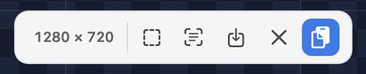
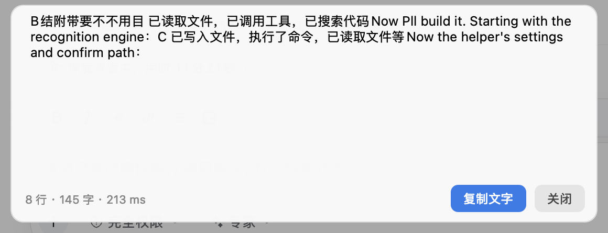
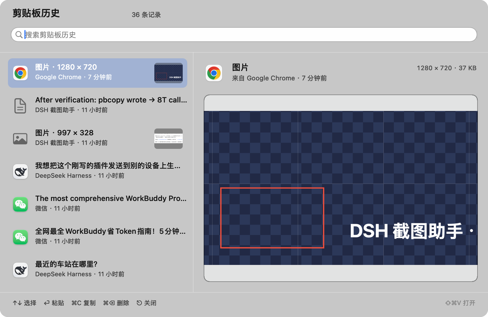
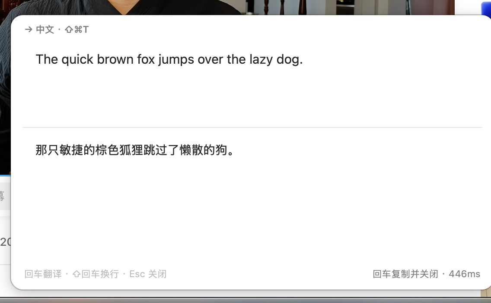
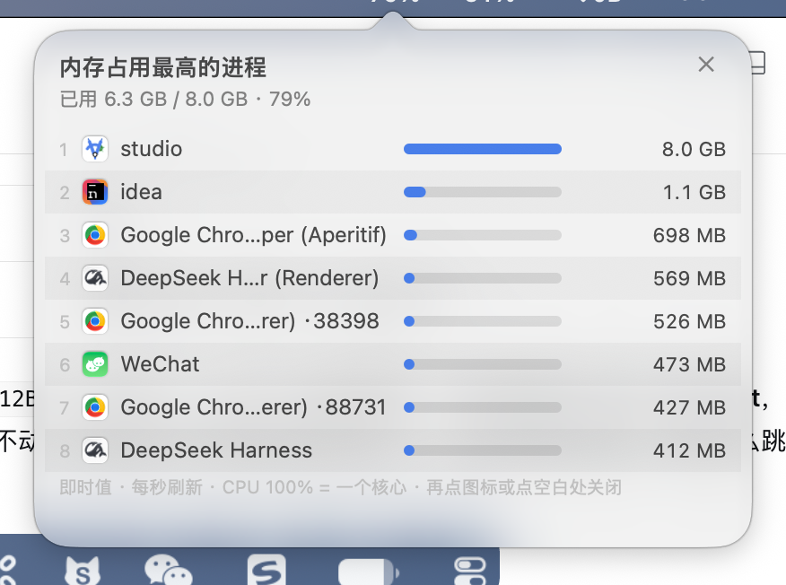

# 原生助手 · DSH Native

四个原生功能合成一个插件包：**截图**、**剪贴板历史**、**翻译**、**系统监控**。

- 界面与全局热键都在一个 Swift 进程里（`helper/DSHNative.app`），四项功能共存于同一个进程；
- 改设置是**热更新**：点完开关/改完快捷键立刻生效，不重启插件、不重拉原生进程（进程 pid 不变）；
- 四项功能各有一个开关，在 **插件 › 原生助手**（详情页里的配置区，或该行的「配置」）里单独开或关：关掉的会被从进程里卸下（热键注销、面板收起），全部关掉时进程退出；
  - 两处都注册了同一个设置页：`plugins.bundle.config`（key = 包名，详情页那条）与 `plugins.row.config`（key = `包名#行id`）。只注册后者时，详情页会认为「这个插件没有配置」，四个开关就无处可显示；
- 配置页里还能改每个功能自己的快捷键与参数，改完即时生效，**不会重启进程**。

| 功能 | 默认快捷键 | 做什么 |
| --- | --- | --- |
| 截图 | `⇧⌘A` | 拖框截屏，选区下方出现工具条：加红框、识别文字、保存，最右端是「复制」、它左边紧挨「取消」；`⌘T` 识别文字，`⌥⏎` 只复制文字 |
| 剪贴板历史 | `⇧⌘V` | 历史面板：搜索、预览、`⏎` 粘贴、`⌘C` 复制、`⌘⌫` 删除 |
| 翻译 | `⇧⌘T` | 浮窗翻译：选中文本按快捷键，或浮窗里输入，`⏎` 复制并关闭 |
| 系统监控 | 无（菜单栏） | 菜单栏三个**两行**控件：上一行是标签或箭头（`CPU` / `MEM` / `↑`），下一行是数字（`26%` / `78%` / `↓1.5K`）；点任一个列出这项指标占用最高的进程（**再点同一个图标、点面板右上角的 ✕、或点屏幕其它地方都会收起来**；点另一个图标则切换指标）—— 每行带**进程所属 App 的图标**（Chrome / DSH 这些 helper 显示宿主 App 的图标；守护进程没有归属 App，那一格留空）、名字、相对比例条与数值 |












## 安装

先把这个目录放到一个固定位置（不要放在会被清理的临时目录，也不要在装好之后移动它）：

```sh
git clone https://github.com/BrightStonebody/dsh-native-tools
# 或者下载 Release 里的 dsh-native-tools.tgz 解压，效果一样
```

Release 上同时挂着 `.tgz` 与 `.zip` 两份同样的内容：`.tgz` 是给 DSH 插件市场的
`tarball:` 字段用的（市场只认 GitHub Release 上的 https `.tgz`），`.zip` 是给人手下载的。

然后：

1. 在该目录里跑一次 `./install.sh`：去掉隔离标记并重新签名 `helper/DSHNative.app`（ad-hoc 签名跨机器搬动后会被 Gatekeeper 拦）。
2. DSH 里打开 **插件 › 添加插件 › 安装第三方插件**，填入上一步那个目录的绝对路径。
3. 重启 DSH，刷新页面。
4. 第一次截图时 macOS 会要求「屏幕录制」权限：到 **系统设置 › 隐私与安全性 › 屏幕录制** 勾选 **DeepSeek Harness**（授权记在宿主 App 名下，重签 helper 不会丢），再按一次快捷键即可。

四个功能默认都是开着的。只想用其中一两个，到 **插件 › 原生助手 › 配置** 把其余的开关关掉。

## 配置项

设置页按功能分成四张卡，每张卡头是开关：

| 分组 | 键 | 默认 | 说明 |
| --- | --- | --- | --- |
| 截图 | `enabled` / `hotkey` | `true` / `cmd+shift+a` | 开关与快捷键（支持任意组合，如 `ctrl+opt+a`、`f8`） |
| 截图 | `saveDirectory` | 空 = 桌面 | 「保存」按钮的默认目录 |
| 截图 | `ocrLanguages` | `auto` | 文字识别语言：`auto` / `zh` / `en` |
| 截图 | `ocrKeepLineBreaks` | `true` | 识别时保留屏幕上的换行 |
| 剪贴板 | `enabled` / `hotkey` | `true` / `cmd+shift+v` | 开关与快捷键 |
| 剪贴板 | `maxItems` / `retentionDays` | `200` / `30` | 历史容量与保留天数 |
| 翻译 | `enabled` / `hotkey` | `true` / `cmd+shift+t` | 开关与快捷键 |
| 翻译 | `provider` / `targetLanguage` | `bing` / `auto` | 翻译通道（仅 `bing`、`google` 可用于浮窗）与目标语言 |
| 系统监控 | `showNetwork` / `showCPU` / `showMemory` | 全 `true` | 三个菜单栏图标各自的开关 |
| 系统监控 | `refreshSeconds` / `topCount` | `2` / `8` | 采样间隔（1–60 秒）与弹层里列几行（3–30） |
| 系统监控 | `networkDetailed` | `true` | 网络图标是否同时显示上行（关掉只留 `↓`，更窄） |
| 全局 | `appPath` | 空 = 包内 helper | 自定义 helper 的 `.app` 路径 |

改任何一项都会把新设置推给正在跑的进程（`adopt` 里带该功能的设置），不需要重启。

翻译通道只有 `bing` 与 `google` 能在浮窗里用：这两个是匿名接口，不需要登录。另外两个
`deepseek-account`、`deepseek-official` 是 DSH 自己的付费通道，翻译结果要记进一个活的会话，
而全局快捷键弹出来的浮窗没有会话，所以设置页里把它们列出来但标成不可选；真写进去也只会得到
「只能在对话里用」这句提示。`google` 需要能直接访问 `translate.googleapis.com`，
连不上的话浮窗会报网络失败，换回 `bing` 即可。

## 架构

```
DSH Host (pid 48684)
 ├─ dsh-native-tools/index.js      配置 + 生命周期 + 翻译请求的 Host 半边
 │    ├── spawn ─────────────► DSHNative.app ── feature screenshot
 │    │                          (一个进程)   ├─ feature clipboard
 │    │                                       ├─ feature translate
 │    │                                       └─ feature monitor
 │    └── Unix socket ◄─────── 翻译用的 host.sock
 └─ 四个功能的 control.sock（各自support目录下）
```

- **谁先起谁当主进程**：每个功能在自己的 socket 上找不到人时，先问共享通道
  `~/Library/Application Support/DSHNative/control.sock`「能不能把我装上」
  （`ensure-feature`），装得上就加入；装不上才 spawn 新进程。新进程抢不到 socket
  就打印 `already-running` 退出，所以**永远只有一个进程**。
- **卸下与退出**：关掉某个功能 → `detach-feature` → 该 feature 停表、注销热键、
  收面板，进程继续跑剩下的功能；全部关 → 进程 5 秒后退出。
- **代交接而非重启**：每次 apply 生成本次运行的 `generation`，`adopt` 时交给进程；
  插件被重新 apply（改配置、重载）时对每个功能发 `release`，代号对得上就只是解除
  挂靠，进程与面板都留着。
- **探活**：每 5 秒查一次 `status`，连续两次没回应就重新接管，接管不上才重新拉起。
- 翻译需要调 DSH 的翻译服务，所以在 Host 侧开着一条 socket（`translate-host.js`），
  原生进程把待译文本发过来、拿译文回去。其他两个功能的逻辑全在原生进程里。

## 目录

```
dsh-native-tools/
├── index.js            Host 半边：配置、spawn/adopt/detach、探活、翻译服务端
├── client.js           设置页（四个开关 + 各自字段）
├── translate-host.js   翻译的 Host 侧实现（从原 dsh-translate 抽出来）
├── cordis.patch.yml    插件声明（id: dsh-native-tools）
├── locale/{zh,en}.json 插件页上的名称与简介
├── icon.svg            插件图标
├── install.sh          去隔离 + 重签 helper
├── pack.sh             打 dist/dsh-native-tools-<版本>.zip 与 .tgz（唯一打包入口）
├── helper/DSHNative.app 通用二进制（arm64 + x86_64），四项功能同一个进程
├── host-test/          Host 半边的热更新自测（改设置不重启、按需 spawn）
├── design/             图标源文件（1024 位图 + iconset）
└── engine/
    ├── build.sh        构建 + 安装（arm64 + x86_64 → lipo → 重签）
    └── Sources/NativeKit/
        ├── main.swift          入口：CLI、join、self-test
        ├── Core/               Log/JSON、热键、控制通道、NativeFeature、NativeHost
        └── Features/
            ├── Screenshot/     截图：覆盖层、工具条、红框、OCR
            ├── Clipboard/      剪贴板历史：存储、面板
            └── Translate/      翻译浮窗
```

每个功能的数据仍在原来的位置（截图 `~/Library/Application Support/DSHScreenshot`，
剪贴板 `…/DSHClipboard`，翻译 `…/DSHTranslate`），从旧版单独插件升级过来不需要迁移。
共享通道在 `…/DSHNative/control.sock`。

## 命令行

```bash
APP=helper/DSHNative.app/Contents/MacOS/DSHNative

$APP --status                          # 四个功能各自的状态（JSON），没在跑则退出码 1
$APP --self-test --feature screenshot  # 20 项
$APP --self-test --feature clipboard   # 55 项
$APP --self-test --feature translate   # 11 项
$APP --self-test --feature monitor     # 44 项
$APP --self-test                       # 四项全跑
$APP --feature screenshot --feature clipboard   # 手动起（可重复，也可逗号分隔）
$APP --feature screenshot --no-adopt   # 不接管已有进程，调试用
```

自测把结果打成 JSON（`checks[]`、`failures`），退出码非 0 表示有失败项。

## 构建

```bash
./engine/build.sh          # 编 arm64 + x86_64 → lipo → 装进 helper/DSHNative.app → 重签
```

只改 JS（`index.js` / `client.js`）不需要构建，但要让运行中的 DSH 用上新代码，得
**重启 DSH**：插件模块在 Host 启动时加载并缓存，`plugin_manager` 的启停不会重新执行
模块体。

## 排查

| 现象 | 处理 |
| --- | --- |
| 插件页里看不到「原生助手」 | 刷新页面；确认装的是这个目录、`package.json` 的 `dsh.bundle.patch` 指向 `cordis.patch.yml` |
| 详情页没有配置区/开关 | 插件页上看不到四个开关时先 ⌘R；改了 `client.js` 要重启 DSH（客户端脚本在宿主启动时读进内存），只刷新页面不会换掉旧脚本 |
| 开关点了没反应 | 看 DSH 日志里 `dsh-native-tools` 的 Host 日志；开关写的是 `['<功能>','enabled']`，Host 派 `loader/volatile-update` 后由插件的 `sync()` 当场把进程对齐（不重启插件） |
| 设置页说「这个插件没有声明可配置项」 | `Config` 里没有 `.volatile()` 字段：DSH 只把 volatile 字段投影进设置表单。本插件除 `appPath` 外的叶子都已声明，见 HANDOFF 坑 12 |
| 翻译报「没有这个翻译通道」 | `provider` 只认 `bing` / `google`（浮窗可用的两个）；写错名字时浮窗会直接说出可用值 |
| 翻译报网络失败 | 用的是 `google` 但访问不到 `translate.googleapis.com`；换 `bing` |
| 按快捷键没反应 | `helper/DSHNative.app/Contents/MacOS/DSHNative --status` 看进程在不在、`permission` 是否 true；日志里找 `hotkey … registered` |
| 截图全黑 / 「需要屏幕录制权限」 | 系统设置 › 隐私与安全性 › 屏幕录制 里勾选 DeepSeek Harness，然后重开 DSH |
| 某个功能关不掉 | 关掉后看 `--status --feature <slug>` 是否消失；全部关掉应看到进程退出 |
| 设了快捷键又变回去 | 配置页写入会即时生效；若进程是旧代码拉起的（进程启动时写死），杀掉进程让它重起 |
| 想彻底停用 | 插件页停用整个插件；或把四个开关都关掉（进程会退出） |

## 分发给别的机器

先在本机打包（版本号取自 `package.json`，会顺手校验 helper 是通用二进制）：

```bash
./pack.sh          # → dist/dsh-native-tools-<版本>.zip 与 dsh-native-tools-<版本>.tgz
                   # 另存 dist/dsh-native-tools.tgz（不带版本号的稳定链接名，Release 用）
```

到新机器上：

1. 解压到**固定目录**（别放「下载」里，插件记住的是这个路径）；
2. `./install.sh`（去 quarantine + 本机重签）；
3. DSH › 插件 › 添加插件 › 安装第三方插件，填解压后的 `dsh-native-tools` 目录；
4. 重启 DSH、刷新页面，到「系统设置 › 隐私与安全性 › 屏幕录制」勾上 DeepSeek Harness。

zip 里带的是运行需要的东西 + `engine/` 源码（对方可以自己重编），不带 `engine/build/` 编译中间产物、`host-test/`、`HANDOFF.md`。helper 是通用二进制，Intel 与 Apple Silicon 都能直接跑。

注意：本地目录是以 `link:` 方式装进 profile 的，装好之后那个目录不能删也不能挪；
配置不随包迁移，需要在新机器上重设（四个开关、快捷键、保存目录都在插件页里改）。
